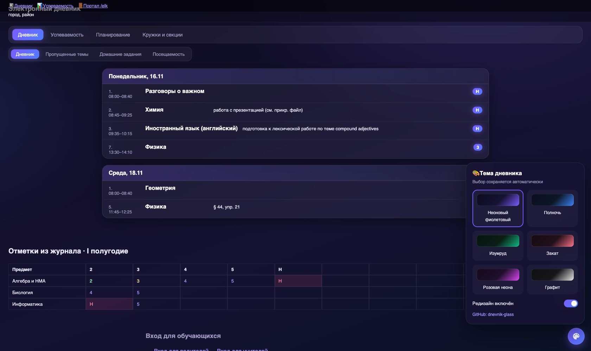

# Дневник: Glass Themes

Тёмный glassmorphism-редизайн электронного дневника «Сетевой Город. Образование»
(проверено на [edu.gounn.ru](https://edu.gounn.ru) — Нижегородская область).

Юзерскрипт перекрашивает Дневник, Успеваемость, портал `/elk` и прочие страницы
в тёмную тему со стеклянными карточками. Цветовая гамма выбирается в панели
настроек — шестерёнка в правом нижнем углу страницы.



## Возможности

- 🎨 **6 цветовых тем**: неоновый фиолетовый (по умолчанию), полночь, изумруд, закат, розовая неона, графит
- 💾 выбор темы сохраняется автоматически (localStorage)
- 🔛 быстрый выключатель редизайна в той же панели
- 📱 адаптив: одинаково выглядит на десктопе, iPad и телефоне
- 🖨 страница печати дневника (`Распечатать`) остаётся светлой — не жрёт краску
- 🧊 стеклянные карточки дней, светящиеся оценки, цветные значения в таблице успеваемости

## Установка

Нужен **один** менеджер userscript'ов (по одному на устройство, не «куча расширений»):

| Платформа | Браузер | Менеджер |
|---|---|---|
| Windows / macOS | Chrome, Edge, Firefox, Яндекс | [Tampermonkey](https://www.tampermonkey.net/) или [Violentmonkey](https://violentmonkey.github.io/) |
| macOS | Safari | приложение [Userscripts](https://apps.apple.com/app/userscripts/id1463298887) |
| iPhone / iPad | Safari | приложение [Userscripts](https://apps.apple.com/app/userscripts/id1463298887) |
| Android | Firefox для Android | Tampermonkey (расширения Firefox работают на Android) |

Дальше:

1. открой [`dnevnik-glass.user.js`](https://github.com/1Pabloki1/dnevnik-glass/raw/main/dnevnik-glass.user.js)
   (в Userscripts на iOS/macOS — положи файл в папку скриптов приложения);
2. менеджер предложит установку → «Установить»;
3. открой дневник — внизу справа появится шестерёнка.

## Использование

Кнопка-шестерёнка → панель «Тема дневника» → клик по превью. Всё применяется мгновенно
и запоминается. Тумблер «Редизайн включён» возвращает оригинальный вид сайта без удаления скрипта.

## Страницы сайта

| Страница | Статус |
|---|---|
| Дневник (`/journal-app/`) | ✅ полностью |
| Успеваемость (`/journal-student-grades-action/`) | ✅ полностью |
| Расписание (`/journal-schedule-action/`) | ✅ полностью |
| Чаты (`/journal-user-vk-chats-action/`) | ✅ |
| Тесты (`/journal-tests-action/`) | ✅ |
| Портфолио (`/journal-portfolio-action/`) | ✅ |
| Профиль (`/journal-user-preferences-action/`) | ✅ |
| Портал `/elk` | ✅ (см. примечание ниже) |
| Страница входа Госуслуг (esia.gosuslugi.ru) | ❌ намеренно не трогаем — чужой гос-домен |

Если после обновления сайта где-то остался светлый блок — пришли скрин
[issue](https://github.com/1Pabloki1/dnevnik-glass/issues).

Портал `/elk` собран с CSS-модулями (классы вида `fmwT93fx...` меняются каждый релиз),
поэтому для него работает рантайм-«отбеливатель»: скрипт снимает светлые фоны напрямую
с элементов. Это чуть менее точная технология, чем статический CSS журнала.

## Как это устроено

- Весь стиль — один CSS со `var(--dg-*)` переменными; тема подставляется плейсхолдерами `{bg0}` → значение.
- Журнальные страницы покрываются статическим CSS по стабильным классам (`dnevnik-day`, `dnevnik-lesson`, `.cell` и т.д.).
- Портал и прочие страницы с хешированными классами — рантайм-проход `flattenWhite()`,
  который вешает `.dg-flattened` / `.dg-glass` на светлые блоки (запускается при загрузке
  и через MutationObserver на SPA-переходы).

## Разработка и тесты

```bash
cd test
npm i playwright-core   # один раз
node shot.js            # скриншоты всех тем × вьюпортов + реальный портал
```

- `test/demo.html` — демо-полигон: мок-разметка Дневника, Успеваемости и портала
  под теми же классами, что на сайте. Открывается локально без логина.
- `test/shot.js` — прогон: 6 тем на десктопе, адаптив (iPad 820px, iPhone 390px),
  реальный публичный портал `/elk` в headless Chrome **свежим профилем**
  (сессия пользователя не затрагивается). Скриншоты падают в `screenshots/`.

## Похожие проекты

- [nm17/netschoolapi](https://github.com/nm17/netschoolapi) — асинхронный Python API-клиент для «Сетевого Города» (неофициальный)
- [lentryd/NetSchoolApi](https://github.com/lentryd/NetSchoolApi) — то же на TypeScript/Node.js
- [mezhendosina/che-zadali-app](https://github.com/mezhendosina/che-zadali-app) — Android-клиент для дневника

Если хочешь **приложение** вместо редизайна сайта — они показывают, как забирать данные
из «Сетевого Города» напрямую.

## Лицензия

MIT. Неофициальный проект, никакого отношения к «Сетевому Городу» и Минобрнауки не имеет.
